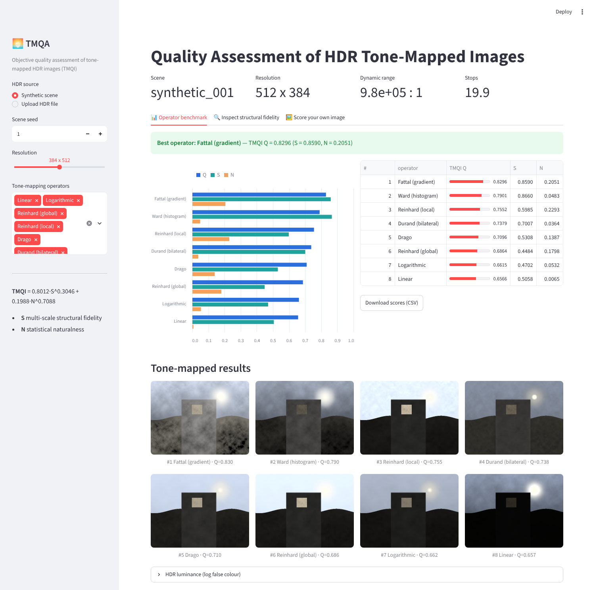
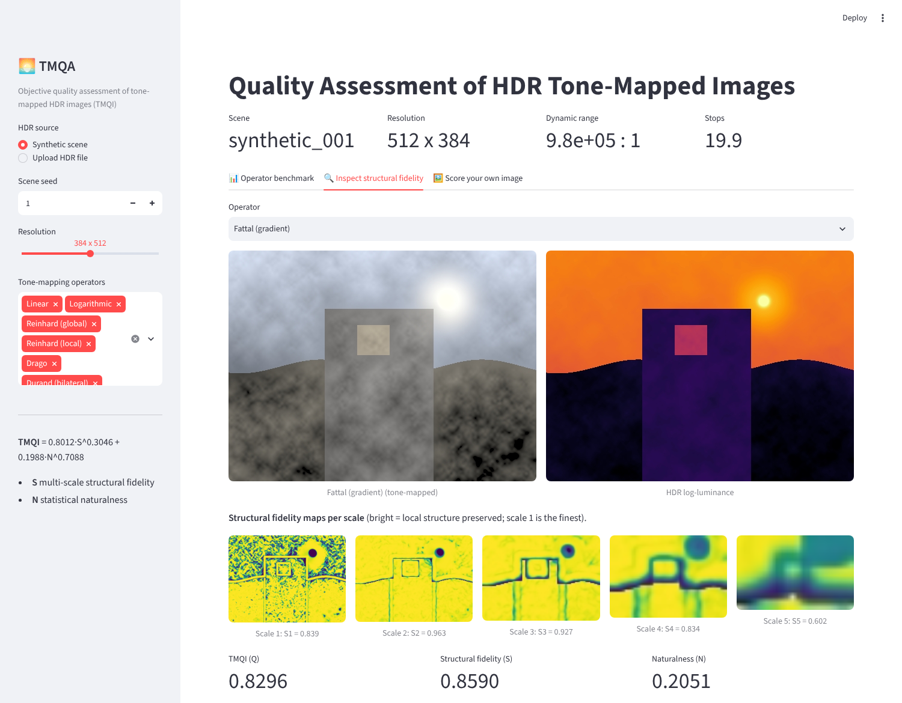
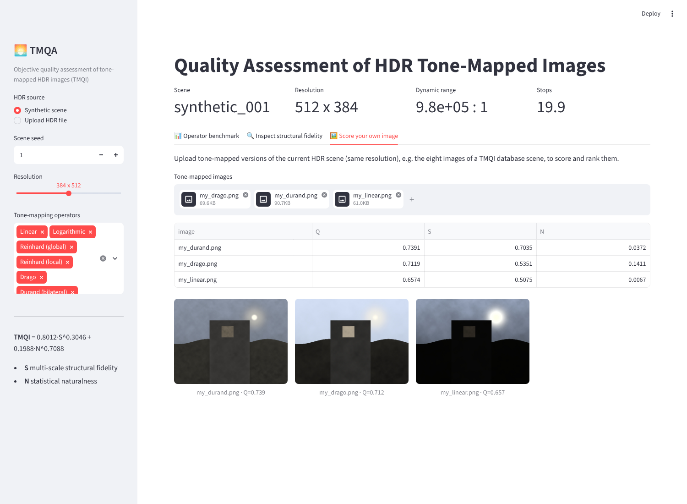

# TMQA: Quality Assessment of HDR Tone-Mapped Images

This project gives an objective quality score to tone-mapped HDR images. The score combines **multi-scale structural
fidelity** with **natural image statistics**, using the Tone-Mapped image Quality Index (TMQI) of
Yeganeh & Wang (IEEE TIP 2013). It also includes **eight tone-mapping algorithms** and the tools to
evaluate them on the **TMQI database**.

## How TMQI works

TMQI compares an HDR reference `H` with a tone-mapped image `L`:

```
Q = a * S^alpha + (1 - a) * N^beta        a = 0.8012, alpha = 0.3046, beta = 0.7088
```

**Structural fidelity `S`** (`tmqa/tmqi.py: structural_fidelity`)

* This is an SSIM-like local comparison with the luminance term removed, because HDR and LDR intensities live on different scales:
  `s = (2 σ'_H σ'_L + C1)/(σ'_H² + σ'_L² + C1) · (σ_HL + C2)/(σ_H σ_L + C2)`.
* Local standard deviations pass through a psychometric function: a Gaussian CDF whose threshold comes from a
  contrast-sensitivity function (CSF) at each scale's spatial frequency. Contrast below the visibility threshold therefore doesn't count.
* The comparison runs at 5 scales (Gaussian 11×11, σ=1.5 window; 2×2 low-pass and dyadic downsampling). The scales are combined with
  the weights `[0.0448, 0.2856, 0.3001, 0.2363, 0.1333]`.

**Statistical naturalness `N`** (`statistical_naturalness`)

* Brightness is the global mean luminance, modelled as a Gaussian (μ=115.94, σ=27.99) that was fitted to about 3,000 natural images.
* Contrast is the mean of the 11×11 block standard deviations, modelled as a Beta(4.4, 10.1) distribution after dividing by 64.29.
* `N` is the product of the two densities, each normalised by its peak, so `N ∈ [0, 1]`.

The filters, constants, block processing and HDR luminance rescaling follow the reference MATLAB release.

## The eight tone-mapping operators

| name | method |
|---|---|
| `linear` | Exposure scaling with clipping (baseline) |
| `logarithmic` | Global logarithmic mapping |
| `reinhard_global` | Reinhard et al. 2002, photographic operator |
| `reinhard_local` | Reinhard et al. 2002, dodging & burning (local) |
| `drago` | Drago et al. 2003, adaptive logarithmic mapping |
| `durand` | Durand & Dorsey 2002, fast bilateral filtering |
| `ward` | Ward Larson et al. 1997, histogram adjustment |
| `fattal` | Fattal et al. 2002, gradient-domain compression (DCT Poisson solver) |

Colour is restored with Schlick's ratio `C_d = (C_w/L_w)^s · L_d`, and the output is gamma 2.2 encoded.

## Installation

```bash
pip install -e .[dev]        # or: pip install -r requirements.txt
```

Radiance `.hdr` and `.pfm` are read natively. `.exr` support needs `imageio`.

## Usage

```bash
# Score tone-mapped images against an HDR reference
python -m tmqa score scene.hdr tm1.png tm2.png [--json]

# Tone-map an HDR image with all eight operators (and score each one)
python -m tmqa tonemap scene.hdr -o out/ --score

# Rank the eight operators by TMQI on the TMQI database
python -m tmqa benchmark --dataset /path/to/TMQI_database -o results/tmqi_benchmark --save-images

# Validate TMQI against the subjective rankings of the database (KRCC / SRCC)
python -m tmqa validate /path/to/TMQI_database -o results/validation

# No dataset? Use procedurally generated HDR scenes
python -m tmqa benchmark --synthetic 6 -o results/synthetic_benchmark
python -m tmqa synth -n 4 -o data/synthetic
```

Python API:

```python
from tmqa import read_hdr, tonemap, tmqi
hdr = read_hdr("scene.hdr")
res = tmqi(hdr, tonemap(hdr, "drago"))
print(res.Q, res.S, res.N, res.s_local)   # res.s_maps holds per-scale fidelity maps
```

## Web UI

Run it locally:

```bash
pip install -e .[ui]
streamlit run app.py          # opens http://localhost:8501
```

* **Operator benchmark**: picks a synthetic scene or an uploaded `.hdr`/`.pfm`/`.exr` file, runs the
  eight operators on it, and ranks them by TMQI with Q/S/N charts, a score table, CSV export and an image gallery.
* **Inspect structural fidelity**: shows the tone-mapped image next to the HDR log-luminance, plus the fidelity
  map for each of the 5 scales.
* **Score your own image**: uploads tone-mapped images (for example the 8 images of a TMQI database scene) and ranks them.





## Using the TMQI database

The TMQI database has 15 HDR scenes, each with 8 tone-mapped images ranked by 20 subjects. The authors
(University of Waterloo, Z. Wang's group) distribute it, and it is **not** included in this repository. Put it in either layout:

```
TMQI_database/
  ranks.csv                 # scene,image,rank   (1 = best); also accepts subjective.csv/scores.csv
  <scene>/
    <scene>.hdr
    <image>.png ...         # the 8 tone-mapped images
```

or use a manifest CSV with the columns `scene,hdr,ldr,subjective` (pass the CSV path instead of a directory).
`validate` computes TMQI, S and N for every image. It then reports the Kendall and Spearman rank correlations with
the subjective ranking for each scene and averaged over the scenes. Ranks are negated, so a positive value means agreement. Use
`--higher-is-better` for MOS-style scores. `benchmark` takes the database HDR images and runs all eight
operators above on them.

## Sample results (synthetic scenes)

These come from `python -m tmqa benchmark --synthetic 6` and are saved in `results/synthetic_benchmark/`:

| operator | Q | S | N | mean rank |
|---|---|---|---|---|
| fattal | 0.834 | 0.858 | 0.226 | 1.0 |
| ward | 0.791 | 0.864 | 0.053 | 2.0 |
| reinhard_local | 0.763 | 0.621 | 0.228 | 3.0 |
| durand | 0.735 | 0.692 | 0.036 | 4.5 |
| drago | 0.723 | 0.567 | 0.141 | 4.7 |
| reinhard_global | 0.704 | 0.491 | 0.182 | 5.8 |
| logarithmic | 0.673 | 0.500 | 0.053 | 7.2 |
| linear | 0.654 | 0.499 | 0.006 | 7.8 |


Local operators that keep detail at every scale (gradient-domain, histogram adjustment, dodging & burning)
get the highest structural fidelity. Global curves lose detail in the shadows or highlights, and plain linear scaling
scores lowest on both terms.

## Tests

```bash
python -m pytest
```

## Reference

H. Yeganeh and Z. Wang, "Objective Quality Assessment of Tone-Mapped Images,"
*IEEE Transactions on Image Processing*, vol. 22, no. 2, pp. 657–667, 2013.
