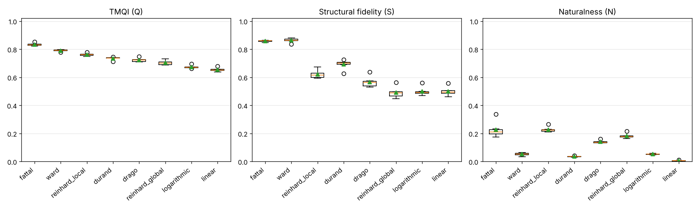

# TMO benchmark on synthetic HDR scenes

6 HDR scenes x 8 tone-mapping operators.

## Operator ranking (by mean TMQI)

| operator | Q_mean | Q_std | S_mean | N_mean | mean_rank | wins |
|---|---|---|---|---|---|---|
| fattal | 0.8337 | 0.0101 | 0.8582 | 0.2263 | 1.0000 | 6.0000 |
| ward | 0.7908 | 0.0067 | 0.8638 | 0.0525 | 2.0000 | 0.0000 |
| reinhard_local | 0.7626 | 0.0092 | 0.6213 | 0.2277 | 3.0000 | 0.0000 |
| durand | 0.7349 | 0.0107 | 0.6923 | 0.0359 | 4.5000 | 0.0000 |
| drago | 0.7233 | 0.0132 | 0.5671 | 0.1406 | 4.6667 | 0.0000 |
| reinhard_global | 0.7042 | 0.0156 | 0.4912 | 0.1818 | 5.8333 | 0.0000 |
| logarithmic | 0.6732 | 0.0107 | 0.4999 | 0.0530 | 7.1667 | 0.0000 |
| linear | 0.6537 | 0.0128 | 0.4993 | 0.0064 | 7.8333 | 0.0000 |

## TMQI Q per scene

| scene | fattal | ward | reinhard_local | durand | drago | reinhard_global | logarithmic | linear |
|---|---|---|---|---|---|---|---|---|
| synthetic_00 | 0.8541 | 0.7776 | 0.7656 | 0.7120 | 0.7270 | 0.7125 | 0.6680 | 0.6371 |
| synthetic_01 | 0.8296 | 0.7901 | 0.7552 | 0.7379 | 0.7096 | 0.6864 | 0.6615 | 0.6566 |
| synthetic_02 | 0.8284 | 0.7969 | 0.7638 | 0.7384 | 0.7243 | 0.7054 | 0.6699 | 0.6479 |
| synthetic_03 | 0.8365 | 0.7981 | 0.7790 | 0.7458 | 0.7485 | 0.7326 | 0.6959 | 0.6480 |
| synthetic_04 | 0.8321 | 0.7890 | 0.7493 | 0.7364 | 0.7089 | 0.6884 | 0.6716 | 0.6788 |
| synthetic_05 | 0.8217 | 0.7929 | 0.7624 | 0.7390 | 0.7212 | 0.6997 | 0.6726 | 0.6538 |

## Figures

